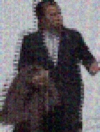
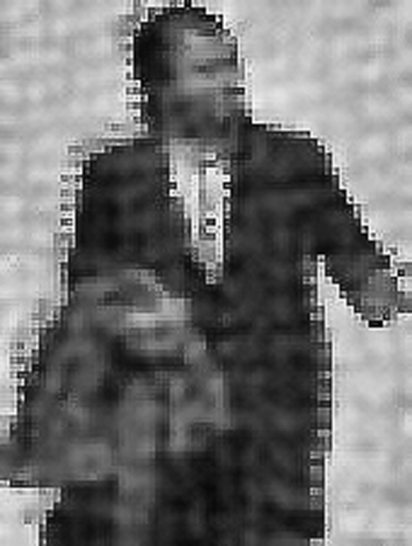
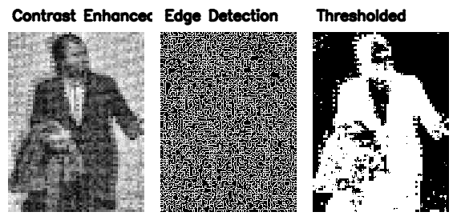
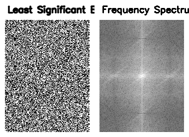
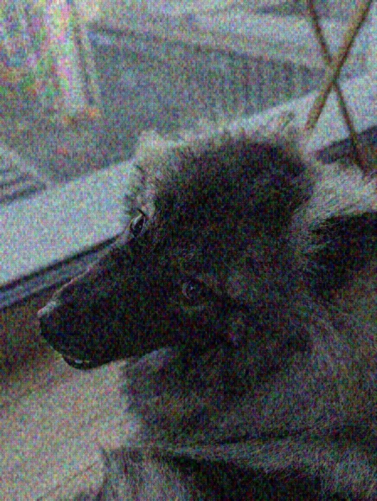

# Adversarial Attack Repository

This repository contains implementations of various adversarial attack methods on neural networks. It is designed to help researchers and practitioners explore adversarial robustness and test different attack strategies against deep learning models.


## Examples
Initial image:


Detection before:
```
🖼️ Image: privat1/images/th3.jpeg
  - suit (ID 835) -> Confidence: 6.3251
  - ski mask (ID 797) -> Confidence: 5.3537
  - abaya (ID 400) -> Confidence: 5.3193
  - trench coat (ID 870) -> Confidence: 5.1354
  - Windsor tie (ID 907) -> Confidence: 4.6823
❌ Forbidden object detected!
```

Obfuscated image:



Detection After 
```
🖼️ Image: privat1/converted/examples/minimal_adv_all_cbbdddb1ae7a55a3.jpeg
  - jigsaw puzzle (ID 612) -> Confidence: 8.2029
  - fur coat (ID 569) -> Confidence: 6.1599
  - bearskin (ID 440) -> Confidence: 5.8124
  - chain mail (ID 491) -> Confidence: 5.3193
  - monastery (ID 664) -> Confidence: 5.2024
✅ Success: No forbidden objects detected.
```

be aware this was run using a combination of all attacks, which is not alwass the best performing option. it was also done using a general target. For best result the target should be choosen sperately for each input image. f.e. for the above a good target might be "abaya" since it already has some confidence there and we could throw it off completely.

More examples are available under: 
[Examples](converted/examples)

## Enhancing & analysis
Examples and tools in /revert

### Enhance1 (contrast enhancement):



Enhance 1 can help better identify the subject of an image.

### Enhance2 (edge detection & thresholding):



As you can see Enhance2's edge detection miserably fails on our protected image. however using threshold we could still make it work.

### Enhance3 (LSB analysis and frequency spectrum):



As you can see even tho we have data embedded in the image the lsb pattern is radnomized very well, making it hard to detect hiddne data. the Frequency spectrumg gives hints to a trained eye that the image has been edited, but also here is to much randomness.

below is a example from ehance 2 & 3 on an unedited image:


As you can see on an unedited picture the patterns are quite different. With enhance 2 you can clearly see the subjects outlines and edges in all pictures. With using enhance 3 you can see a more natural pattern for the LSB analysis, thsi is to be expected. in the FS you can clearly see how clean the lines would be on a standard camera captureed image. 

## 🛠️ Modernized Features (2026 Edition)
- **Real-World Models**: Attacks now utilize MobileNetV2 via TensorFlow Hub instead of dummy models.
- **Improved Performance**: Multi-threaded batch processing for high-volume protection.
- **Standardized CLI**: Unified command-line interface for all modules.
- **Minimal Quality Loss**: "Upscale-Delta" logic preserves original resolution while maintaining attack effectiveness.

## ⚙️ Installation & Setup

### 0. Prerequisites
- **Python Version**: 3.10, 3.11, or **3.12** (Recommended).
  - *Note: Python 3.13 is currently not supported due to TensorFlow and NumPy 1.x compatibility limits.*
- **System**: macOS (Required for `tensorflow-metal` acceleration).

### 1. Create and Activate Virtual Environment
It is highly recommended to use a virtual environment to manage dependencies. Ensure you are using a supported Python version (e.g., 3.12).

```bash
# Create a virtual environment using Python 3.12
python3.12 -m venv .venv

# Activate the virtual environment
source .venv/bin/activate
```

### 2. Install Dependencies
Ensure your `pip` is up to date and install the required libraries:
```bash
python -m pip install --upgrade pip
python -m pip install -r requirements.txt
```

> [!IMPORTANT]
> This repository is optimized for **macOS** with `tensorflow-macos` and `tensorflow-metal` for hardware acceleration. Using Python 3.12 ensures all C-extensions for NumPy and TensorFlow load correctly on Apple Silicon.

## 📂 Files Overview

### Main Module
- **`src/privat1.py`**: The primary orchestration tool. Chains multiple distortions (pixel shift, perspective warp, etc.) and adversarial attacks (PGD, FGM) into a production-ready pipeline. Supports parallel processing via the `--workers` flag.

### Attack Modules (Root Directory)
- **`PGD.py`**: Projected Gradient Descent. A strong iterative attack with modern CLI support.
- **`FGM.py`**: Fast Gradient Method. A classic single-step gradient-based attack with standardized scaling logic.
- **`APA.py`**: Adversarial Patch Attack. Generates localized patches to force misclassification.
- **`OPA.py`**: One-Pixel Attack. Modifies a minimal set of pixels to disrupt feature recognition.
- **`STAA.py`**: Spatial Transformation Adversarial Attack. Uses small rotations and translations to break detection.
- **`carlini_wagner.py`**: Optimized L2-based attack for high-confidence obfuscation.

### Utilities
- **`src/helpers.py`**: Core utility for loading and caching ART-wrapped TensorFlow Hub models. Optimized for `tensorflow-metal`.
- **`verify.py`**: Forensic classification tool used to test the effectiveness of protections against forbidden ImageNet classes. Supports directory-wide scanning.

### Specialized Variants (In `/src`)
- **`src/steg.py`**: Advanced LSB steganography and metadata header manipulation for structural confusion.
- **`src/NBP.py`**: Targeted module for Noise, Blur, and Pixelation (NBP).
- **`src/PSPM.py`**: Specialized Pixel-Shift and Pattern-Masking (PSPM) module.

## 🚀 Usage

### 🛡️ High-Intensity Protection (Main Flow)
Use the main module to process an entire directory of images with chained protections.

```bash
python3 src/privat1.py --input images/ --output converted/protected/ --workers 8 --eps 0.05
```
**Options:**
*   `--eps`: Attack strength (higher = more protection, more visible noise). Default: 0.05.
*   `--workers`: Number of parallel threads (recommended: 4-8 on Apple Silicon).
*   `--no-adv`: Disable adversarial noise and use only structural distortions.
*   `--assets`: (Optional) path to distractor images to blend into the background.

### 🧪 Testing Individual Attacks
Each root script can be run independently for targeted testing on a single image.

```bash
# Apply a PGD attack targeting class 262 (Keeshond)
python3 PGD.py images/sample.jpg output_pgd.jpg --eps 0.08 --iters 20 --target 262

# Apply an Adversarial Patch
python3 APA.py images/sample.jpg output_patch.jpg --scale 0.25 --target 835
```

### 🔍 Verifying Protection
Run the verification tool to see if ImageNet-based classifiers can still identify forbidden objects.

```bash
# Check a single image
python3 verify.py output_pgd.jpg --forbidden "keeshond, suit, trench coat"

# Analyze a whole directory
python3 verify.py converted/protected/ --forbidden "person, mask"
```

## Running the Code

This repository is currently only compatible with macOS, as it relies on `tensorflow-macos` and `tensorflow-metal` for acceleration. Ensure that you have the required Python libraries installed before running the scripts:
```
pip install -r requirements.txt
```

## Contribution
Feel free to contribute by improving existing implementations, adding new adversarial attacks, or refining the evaluation metrics.

## License
This project is released under an open-source license. Use it for research and educational purposes only.

## Limitations and Caveats

While Privat1 provides advanced obfuscation against AI detection, users should be aware of the following limitations:

- **Visibility of Perturbations**: At high epsilon values (attack strength), noise and distortions may become visually apparent to the human eye. Balancing protection and image quality is key.
- **Denoising Countermeasures**: Sophisticated AI systems may use denoising or image reconstruction filters (e.g., GAN-based enhancement) to partially "clean" adversarial noise. No protection is 100% foolproof.
- **Compression Sensitivity**: Saving protected images with very low JPEG quality can sometimes "wash out" fine-grained adversarial perturbations, potentially restoring detection confidence.
- **Hardware Dependency**: For optimal performance, this repository relies on macOS with `tensorflow-macos` and `tensorflow-metal`. Running on other systems may be significantly slower.
- **Detection of Anomaly**: While the subject may be misclassified, the presence of high-frequency adversarial noise can itself be a signal for "adversarial detection" systems that specifically look for edited images.

## advanced usage
...

analyze input image using imagenet using verify.py
```
🖼️ Image: privat1/images/img4sm.jpeg
  - keeshond (ID 262) -> Confidence: 8.0951
  - schipperke (ID 224) -> Confidence: 5.3002
  - groenendael (ID 225) -> Confidence: 4.9950
  - Pomeranian (ID 260) -> Confidence: 4.9746
  - langur (ID 375) -> Confidence: 4.5492
  - indri (ID 385) -> Confidence: 3.5839
  - Shetland sheepdog (ID 231) -> Confidence: 3.4943
  - Chihuahua (ID 152) -> Confidence: 3.4302
  - Norwegian elkhound (ID 175) -> Confidence: 3.3912
  - Madagascar cat (ID 384) -> Confidence: 3.0115
❌ Forbidden object detected!
```

we will try throwing it off using "Norwegian elkhound" for the first iteration.
We will only run PGD & FGM, to get best results we play around with the settings a little and use multiple iterations until we end up with this:
```
🖼️ Image: privat1/converted/no_metadata_P3_fc38241dd4e7acc6.jpeg
  - window screen (ID 905) -> Confidence: 7.0242
  - skunk (ID 362) -> Confidence: 5.4991
  - gorilla (ID 367) -> Confidence: 5.2047
  - tabby (ID 282) -> Confidence: 4.6789
  - sloth bear (ID 298) -> Confidence: 4.1550
  - mosquito net (ID 670) -> Confidence: 4.0545
  - chow (ID 261) -> Confidence: 3.9916
  - Madagascar cat (ID 384) -> Confidence: 3.9874
  - wood rabbit (ID 331) -> Confidence: 3.9713
  - titi (ID 381) -> Confidence: 3.9481
✅ Success: No forbidden objects detected.
```

